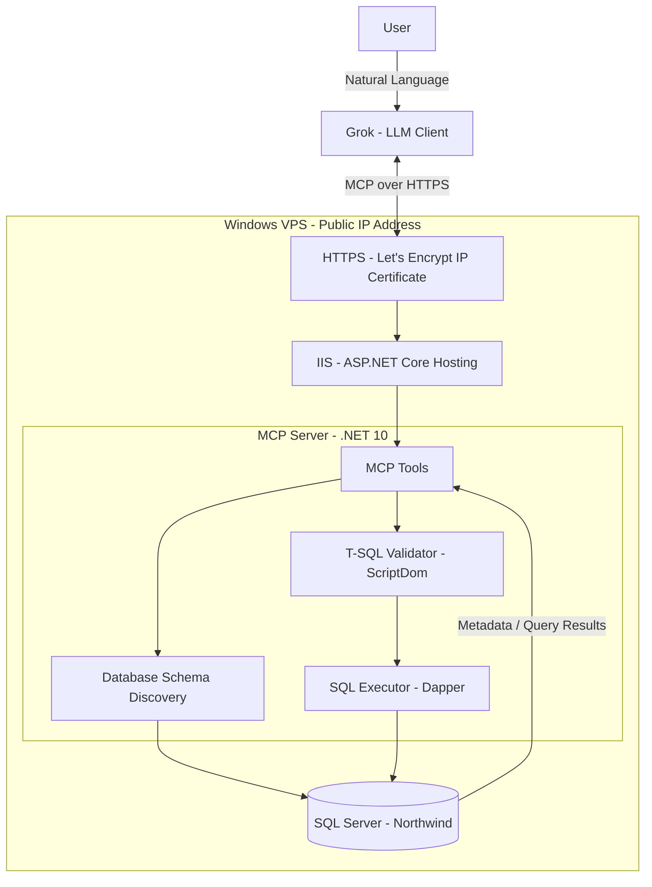
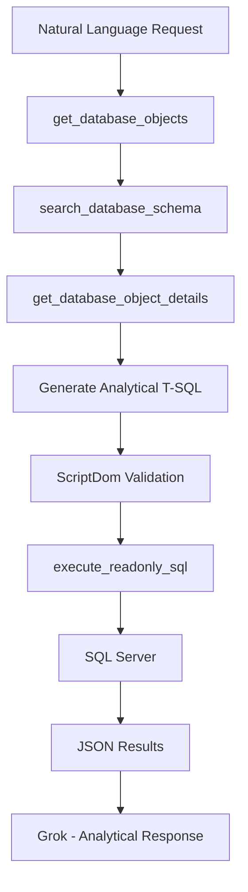
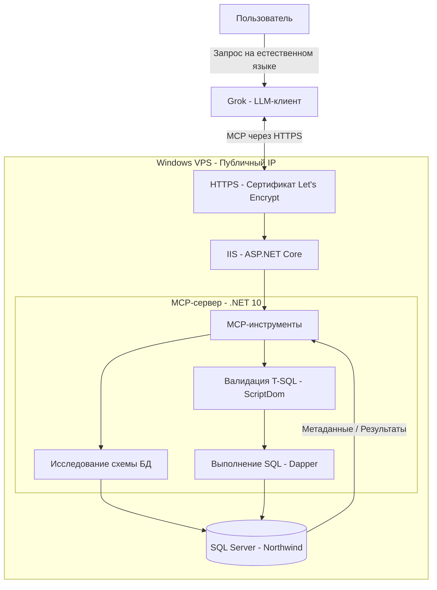
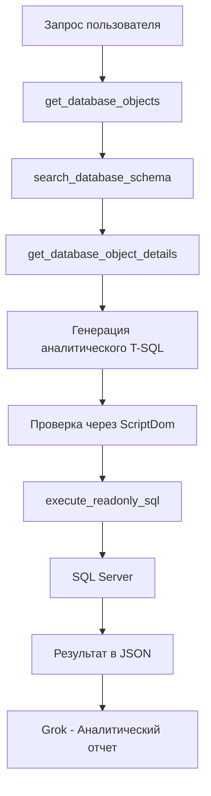

## Description

An experimental MCP (Model Context Protocol) server built with **C# / .NET 10**, ASP.NET Core, Dapper, and Microsoft SQL Server.

The project demonstrates how Large Language Models (LLMs) can explore relational databases, discover schemas and relationships, generate analytical T-SQL queries, and execute them through MCP tools using natural language requests.

The main goal is to provide a foundation for **AI-driven database analytics** without implementing dedicated API endpoints or hardcoded SQL queries for individual reports.

### Architecture

The application is deployed on a remote **Windows VPS** running IIS and Microsoft SQL Server.

Instead of purchasing a domain name, the project uses the VPS public IP address. An HTTPS certificate was issued directly for the IP address using **Let's Encrypt and Posh-ACME**.

The MCP server is hosted as an ASP.NET Core application under IIS. The Northwind sample database is deployed on the same VPS.

**Grok** is used as an external LLM client to test MCP integration, database schema discovery, SQL generation, and analytical reporting.

### Technology Stack

| Technology | Purpose |
|---|---|
| C# / .NET 10 | Application development |
| ASP.NET Core | HTTP hosting |
| ModelContextProtocol.AspNetCore | MCP server implementation |
| Microsoft SQL Server | Relational database |
| Dapper | Database access and query execution |
| Microsoft.Data.SqlClient | SQL Server connectivity |
| Microsoft.SqlServer.TransactSql.ScriptDom | T-SQL parsing and validation |
| IIS | Application hosting on Windows VPS |
| Let's Encrypt / Posh-ACME | HTTPS certificate for public IP |
| Grok | External LLM client for testing |

### Implemented MCP Tools

#### Database Schema Discovery

| Tool | Description |
|---|---|
| `get_database_tables` | Returns database tables, views, and their column metadata |
| `get_database_relationships` | Returns foreign key relationships between database objects |
| `get_database_keys` | Returns primary and unique key constraints |
| `get_database_objects` | Returns a lightweight catalog of tables and views with optional schema filtering |
| `search_database_schema` | Searches objects by table names, column names, and `MS_Description` metadata |
| `get_database_object_details` | Returns detailed metadata for selected objects, including columns, keys, and incoming/outgoing foreign keys |

#### SQL Execution

| Tool | Description |
|---|---|
| `execute_readonly_sql` | Validates and executes analytical T-SQL SELECT queries and returns JSON results |

#### Development Utilities

| Tool | Description |
|---|---|
| `say_hello` | Simple MCP connectivity test |
| `add_numbers` | Tests tool arguments and results |
| `get_server_time` | Returns the server's current time |

### Progressive Schema Discovery

Instead of sending the entire database structure to the LLM, the server supports **progressive metadata exploration**.

This approach allows the LLM to:

- Discover available tables and views without loading every column.
- Search database metadata by object names, column names, and descriptions.
- Retrieve detailed information only for relevant database objects.
- Identify primary keys, composite keys, and foreign key relationships.
- Explore relationships in both directions.
- Generate SQL JOINs based on actual database metadata.
- Execute analytical queries and interpret the results.

The approach can be extended to larger enterprise database schemas.

### SQL Validation and Execution

The SQL execution component uses **Microsoft.SqlServer.TransactSql.ScriptDom** to parse T-SQL into an Abstract Syntax Tree (AST).

The current implementation includes:

- SQL syntax validation.
- Restriction to a single SELECT statement.
- Rejection of common data modification and DDL statements.
- Rejection of `SELECT INTO`.
- Support for CTEs, JOINs, aggregations, and window functions.
- Configurable SQL command timeout.
- Limits on returned rows and response size.
- Execution using a dedicated SQL Server account with restricted database permissions.

The SQL executor returns structured JSON containing query results, returned row count, and a truncation indicator.

> [!WARNING]
> This is an experimental implementation. AST validation and database permissions provide basic safeguards but do not constitute a complete SQL sandbox.
>
> Additional query restrictions, resource controls, authentication, and auditing are required before production use. The current public MCP deployment does not implement client authentication.

### Testing with Grok

The solution was tested using the **Northwind** sample database hosted on the remote VPS.

The LLM successfully:

- Discovered 13 tables and 16 views.
- Searched database metadata by names and columns.
- Identified composite primary keys.
- Resolved incoming and outgoing foreign key relationships.
- Retrieved metadata for selected tables and views.
- Generated analytical SQL queries from natural language requests.
- Executed reporting queries using JOINs, CTEs, aggregations, and window functions.
- Rejected tested modification and DDL statements through the SQL execution tool.

Example analytical requests:

> Show total sales by employee for orders shipped to the USA in 1997.

> Find the top three products in each category and compare their sales between 1996 and 1997.

The reports were generated without creating dedicated reporting endpoints or writing report-specific SQL in the MCP server.

### Project Status

**Proof of Concept (PoC)**

The core MCP integration, database schema discovery, metadata search, SQL validation, and analytical query execution have been implemented and tested.

Potential future improvements:

- SQL execution logging and auditing.
- Configurable business metadata and metric definitions.
- View dependency discovery.
- Stronger SQL query restrictions.
- MCP client authentication.

---

## Описание

Экспериментальный MCP-сервер, разработанный на **C# / .NET 10** с использованием ASP.NET Core, Dapper и Microsoft SQL Server.

Проект демонстрирует возможность интеграции больших языковых моделей (LLM) с реляционной базой данных для автоматического исследования ее структуры, определения связей между таблицами, генерации аналитических T-SQL-запросов и выполнения отчетов на естественном языке.

Основная идея — создать универсальную основу для **AI-аналитики поверх SQL Server**, без необходимости разрабатывать отдельные API-методы и SQL-запросы под каждый отчет.

### Архитектура

Проект развернут на удаленном **Windows VPS** с установленными IIS и Microsoft SQL Server.

Для тестирования не приобретался отдельный домен. Вместо этого используется публичный IP-адрес VPS, для которого был выпущен HTTPS-сертификат через **Let's Encrypt с использованием Posh-ACME**.

MCP-сервер опубликован как ASP.NET Core-приложение в IIS. На этом же VPS развернута тестовая база данных Northwind.

В качестве внешнего LLM-клиента используется **Grok**, через который проверяются подключение к MCP, исследование схемы БД, генерация SQL и построение аналитических отчетов.

### Технологический стек

| Технология | Назначение |
|---|---|
| C# / .NET 10 | Разработка приложения |
| ASP.NET Core | HTTP-хостинг |
| ModelContextProtocol.AspNetCore | Реализация MCP-сервера |
| Microsoft SQL Server | Реляционная база данных |
| Dapper | Доступ к БД и выполнение запросов |
| Microsoft.Data.SqlClient | Подключение к SQL Server |
| Microsoft.SqlServer.TransactSql.ScriptDom | Разбор и проверка T-SQL |
| IIS | Размещение приложения на Windows VPS |
| Let's Encrypt / Posh-ACME | HTTPS-сертификат для публичного IP |
| Grok | Внешний LLM-клиент для тестирования |

### Реализованные MCP-инструменты

#### Исследование структуры базы данных

| Метод | Назначение |
|---|---|
| `get_database_tables` | Получение таблиц, представлений и метаданных колонок |
| `get_database_relationships` | Получение внешних ключей и связей между объектами |
| `get_database_keys` | Получение первичных и уникальных ключей |
| `get_database_objects` | Получение компактного каталога таблиц и представлений с фильтрацией по схеме |
| `search_database_schema` | Поиск объектов по названиям таблиц, колонок и описаниям `MS_Description` |
| `get_database_object_details` | Получение подробных метаданных выбранных объектов, включая колонки, ключи и внешние связи |

#### Выполнение SQL

| Метод | Назначение |
|---|---|
| `execute_readonly_sql` | Проверка и выполнение аналитических T-SQL SELECT-запросов с возвратом результатов в JSON |

#### Тестовые инструменты

| Метод | Назначение |
|---|---|
| `say_hello` | Проверка подключения к MCP |
| `add_numbers` | Проверка передачи параметров и результатов |
| `get_server_time` | Получение текущего времени сервера |

### Поэтапное исследование схемы БД

Вместо передачи всей структуры базы данных языковой модели реализован механизм **Progressive Schema Discovery** — поэтапного исследования метаданных.

Этот механизм позволяет языковой модели:

- Получать список таблиц и представлений без загрузки всех колонок.
- Искать необходимые объекты по названиям и описаниям.
- Запрашивать подробную структуру только выбранных таблиц.
- Определять первичные, составные и внешние ключи.
- Исследовать связи между таблицами в обоих направлениях.
- Формировать JOIN на основании реальных метаданных SQL Server.
- Генерировать и выполнять аналитические SQL-запросы.

Такой подход рассчитан не только на небольшие тестовые базы, но и на дальнейшую работу с корпоративными БД, содержащими сотни таблиц и представлений.

### Валидация и выполнение SQL

Для проверки SQL-запросов используется библиотека **Microsoft.SqlServer.TransactSql.ScriptDom**, которая разбирает T-SQL в абстрактное синтаксическое дерево (AST).

В текущей реализации предусмотрены:

- Проверка синтаксиса SQL.
- Ограничение выполнения одним SELECT-запросом.
- Отклонение стандартных команд изменения данных и структуры БД.
- Запрет `SELECT INTO`.
- Поддержка CTE, JOIN, группировок и оконных функций.
- Настраиваемый таймаут выполнения SQL.
- Ограничение количества возвращаемых строк и размера ответа.
- Выполнение запросов через отдельную учетную запись SQL Server с ограниченными правами.

Результат возвращается в JSON с данными, количеством строк и признаком усечения результата.

> [!WARNING]
> Проект является экспериментальным. Проверка AST и ограничение прав SQL-пользователя не обеспечивают полноценную изоляцию произвольного T-SQL.
>
> Для промышленного использования необходимо усилить ограничения запросов, контроль ресурсов, аудит и авторизацию MCP-клиентов. В текущем публичном развертывании авторизация MCP пока не реализована.

### Тестирование с Grok

Для тестирования использовалась база данных **Northwind**, развернутая на удаленном VPS.

В ходе тестирования Grok успешно:

- Обнаружил 13 таблиц и 16 представлений.
- Выполнил поиск объектов по названиям и колонкам.
- Определил составные первичные ключи.
- Обнаружил входящие и исходящие внешние связи.
- Получил подробные метаданные выбранных таблиц и представлений.
- Сгенерировал аналитические SQL-запросы по текстовому описанию.
- Построил отчеты с использованием JOIN, CTE, агрегатных и оконных функций.
- Получил ошибки при попытках выполнить протестированные команды изменения данных и структуры БД.

Примеры аналитических запросов:

> Покажи общую сумму продаж по сотрудникам для заказов, отправленных в США в 1997 году.

> Найди три самых продаваемых товара в каждой категории и сравни их продажи за 1996 и 1997 годы.

Отчеты были построены без разработки специализированных API-методов и без предварительного написания SQL под конкретные задачи.

### Статус проекта

**Proof of Concept (PoC)**

Реализованы и протестированы базовая MCP-интеграция, исследование схемы базы данных, поиск метаданных, валидация SQL и выполнение аналитических запросов.

Возможные направления дальнейшего развития:

- Логирование и аудит SQL-запросов.
- Конфигурируемые бизнес-метаданные и определения метрик.
- Исследование зависимостей представлений.
- Усиление SQL-валидатора.
- Авторизация MCP-клиентов.
